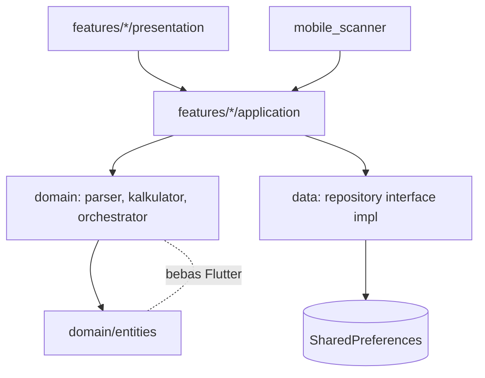

# 03 — System Architecture

> Keputusan arsitektur: `00_DECISION_LOG.md` D-04 … D-09, D-24 … D-41.

## 1. Pendekatan

Aplikasi Flutter satu paket, offline, tanpa backend. Tiga layer dengan arah dependensi satu arah:



Aturan keras:

- `domain/` **tidak boleh** mengimpor `flutter/material.dart`, `shared_preferences`, atau plugin apa pun.
- `domain/` hanya boleh bergantung pada `dart:core`, `dart:typed_data`, `dart:convert` (untuk UTF-8).
- `presentation/` tidak boleh memanggil repository langsung; selalu lewat `application/`.
- Tidak ada `features/*/domain`. Satu rumah untuk logika domain (D-37).

## 2. Struktur folder

```text
lib/
├── main.dart                     # initializeDateFormatting, ProviderScope, runApp
├── app/
│   ├── goldpay_app.dart          # MaterialApp, locale id_ID, theme
│   ├── router.dart               # GoRouter
│   └── theme/
│       ├── tokens.dart           # warna, spasi, radius (sumber: doc 09)
│       └── theme.dart            # ThemeData + typography
├── core/
│   ├── constants/
│   │   ├── copy_id.dart          # SEMUA teks UI (doc 18)
│   │   └── demo_config.dart      # DemoPricingConfig
│   ├── errors/
│   │   ├── result.dart           # sealed Result<T>
│   │   └── failure.dart          # Failure + kode
│   ├── formatters/
│   │   ├── money.dart            # Rp150.000
│   │   └── gold.dart             # 0,1021 g
│   └── widgets/                  # AppButton, DemoBanner, InfoRow, EmptyState
├── domain/
│   ├── entities/
│   │   ├── qris_parse_result.dart
│   │   ├── conversion_quote.dart
│   │   ├── demo_transaction.dart
│   │   └── demo_state.dart
│   ├── qris/
│   │   ├── tlv.dart              # parser TLV berbasis byte
│   │   ├── crc16.dart            # CRC-16/CCITT-FALSE
│   │   └── qris_parser.dart      # orkestrasi + sanitasi
│   ├── pricing/
│   │   ├── gold_conversion_calculator.dart
│   │   └── quote_validator.dart
│   └── transaction/
│       ├── demo_payment_orchestrator.dart
│       └── transaction_state.dart
├── data/
│   ├── demo_state_codec.dart     # toJson/fromJson + migrasi
│   └── prefs_demo_repository.dart
└── features/
    ├── home/{presentation,application}
    ├── scanner/{presentation,application}
    ├── checkout/{presentation,application}
    ├── transactions/{presentation,application}
    └── demo_settings/{presentation,application}
test/
├── domain/qris/                  # TLV, CRC, parser (fixture F01–F10)
├── domain/pricing/               # kalkulator, validator
├── data/                         # repository, codec, recovery
└── features/                     # widget test
```

## 3. Dependency injection

Riverpod tanpa codegen (D-38):

```dart
final demoRepositoryProvider = Provider<DemoRepository>((ref) {
  throw UnimplementedError('override di ProviderScope');
});
final demoStateProvider = AsyncNotifierProvider<DemoStateNotifier, DemoState>(...);
final quoteProvider = NotifierProvider<QuoteNotifier, QuoteState>(...);
```

- Repository di-override di `main()` (produksi) dan di setiap test (fake/failing fake).
- Tidak ada singleton global yang bisa diakses dari `domain/`.
- `DemoPricingConfig` disediakan lewat provider agar test bisa memakai harga berbeda.

## 4. Model error

Parse gagal, saldo kurang, dan quote kedaluwarsa adalah **kondisi normal**, bukan exception.

```dart
sealed class Result<T> {
  const Result();
}
final class Ok<T> extends Result<T> { final T value; const Ok(this.value); }
final class Err<T> extends Result<T> { final Failure failure; const Err(this.failure); }
```

- Exception hanya untuk bug pemrograman (mis. `StateError`).
- `Failure` membawa kode (`QrisErrorCode`, `QuoteFailure`, `StorageFailure`) yang dipetakan ke copy.
- Jangan menampilkan `toString()` exception ke pengguna.

## 5. Data flow

```
Camera / paste / gallery
        │  String payload
        ▼
QrisPayloadParser (domain, pure)  ──►  QrisSuccess | QrisFailure
        │
        ▼
CheckoutController (application)  ──►  PaymentDraft (nominal + merchant)
        │
        ▼
GoldConversionCalculator (domain) ──►  ConversionQuote (5 menit)
        │
        ▼
DemoPaymentOrchestrator (domain)  ──►  commit lewat DemoRepository
        │
        ▼
DemoStateNotifier (application)   ──►  UI: result, history, balance
```

Controller yang dibutuhkan:

| Controller | Tanggung jawab |
|---|---|
| `ScannerController` | Lifecycle kamera, dedupe decode, sumber (kamera/galeri/tempel) |
| `CheckoutController` | Draft, nominal (read-only/input), transisi ke quote |
| `QuoteController` | Hitung ulang quote, timer kedaluwarsa, validasi |
| `DemoTransactionController` | Confirm, lock, commit, hasil |
| `HistoryController` | Baca state, urutkan, cari transaksi |
| `DemoSettingsController` | Tambah saldo, reset, toggle gagal, fallback |

## 6. Scanner

- Satu `MobileScannerController` dimiliki `ScannerController`, `autoStart: false`.
- Start saat route aktif, stop saat `dispose`/background (`WidgetsBindingObserver`).
- `DetectionSpeed.noDuplicates` **plus** flag `_handled` (jangan bergantung pada satu mekanisme).
- `onDetect` → `controller.stop()` segera → kirim payload ke parser.
- `analyzeImage` untuk jalur galeri; hasil diperlakukan sama.
- Permission: minta saat tombol Scan ditekan; jika `permanentlyDenied`, tampilkan jalur pengaturan.
- Jangan menyimpan gambar atau payload.

## 7. Offline dan permission

- Tidak ada `http`, `dio`, `firebase`, atau analytics.
- Manifest release menghapus `android.permission.INTERNET` (D-06).
- ML Kit (lewat `transport-backend-cct`) menambahkan `ACCESS_NETWORK_STATE`. Permission itu
  hanya membaca status konektivitas dan **tidak** memberi akses jaringan; tanpa `INTERNET`
  tidak ada byte yang bisa dikirim. Tidak dihapus agar telemetry ML Kit tidak melempar
  `SecurityException`.
- `google_fonts` tidak dipakai; font dari `assets/fonts/` (D-07).
- Bukti: `aapt dump permissions app-release.apk` tidak memuat `INTERNET`.

## 8. ADR

| ID | Keputusan | Konsekuensi |
|---|---|---|
| ADR-001 | Flutter, Android-only | Cepat dibangun; tidak ada jalur iOS |
| ADR-002 | Offline, tanpa backend | Demo deterministik; tidak ada rekonsiliasi nyata |
| ADR-003 | Scanner dan parser terpisah | Decode ≠ validasi pembayaran |
| ADR-004 | Engine transaksi demo eksplisit | Nama metode tidak boleh menyiratkan pembayaran nyata |
| ADR-005 | Satu blob state + snapshot `_prev` | Atomik secara urutan, bukan transaksi DB; cukup untuk 200 record |
| ADR-006 | Tanpa permission INTERNET di release | Klaim "tidak bisa membayar" dapat dibuktikan |
| ADR-007 | Layer-first domain | Parser/kalkulator dapat diuji tanpa Flutter |
| ADR-008 | Hanya `completed_demo` dipersist | History bersih; tidak ada pending menggantung |
| ADR-009 | CRC soft-fail | Demo tetap berjalan dengan QRIS nyata yang CRC-nya rusak |

## 9. Batas error

| Area | Perilaku |
|---|---|
| Kamera tidak tersedia/ditolak | Layar penjelasan + pengaturan + jalur galeri/tempel |
| Parser gagal | Pesan spesifik + Scan ulang, tanpa data karangan |
| Nominal tidak valid | Tombol nonaktif + pesan inline |
| Saldo kurang | Tombol nonaktif + kekurangan dalam Rp dan gram |
| Quote kedaluwarsa | Tombol "Perbarui penawaran" |
| Storage gagal | Layar gagal, saldo tidak berubah, tidak ada struk |
| Storage rusak | Pemulihan `_prev`, atau layar reset eksplisit |

## 10. Kinerja

Target di perangkat kelas menengah (2020+):

| Operasi | Target |
|---|---|
| Parse payload | < 16 ms (satu frame) |
| Hitung quote | < 2 ms |
| Baca state | < 50 ms |
| Commit state | < 100 ms |
| Waktu buka kamera | < 1,5 s |

Tidak ada pekerjaan berat di `build()`. Tidak ada `setState` pada widget root untuk perubahan saldo.
