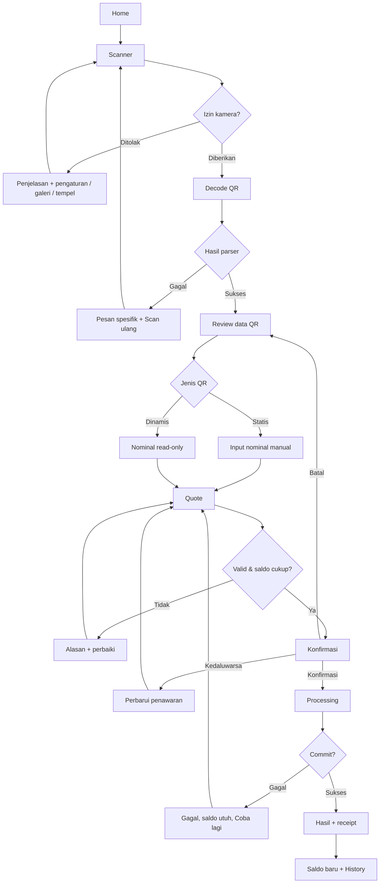

# 06 — User Journeys dan Alur

> Implementasi state mengikuti `11_TRANSACTION_STATE_MACHINE.md`. Teks memakai
> `18_UI_COPY_ID.md`.

## 1. Alur utama (60–90 detik)

1. Buka aplikasi; Home menampilkan saldo, harga simulasi, dan disclosure.
2. Tekan **Scan QRIS**; kamera meminta izin (pertama kali).
3. Pindai QR; kamera berhenti setelah satu hasil.
4. Parser membaca payload. Jika gagal → pesan spesifik + Scan ulang.
5. Review: nama/kota/penerbit jika ada, jenis QR, status CRC (sebagai informasi, bukan verifikasi).
6. Nominal:
   - **Statis** → pengguna memasukkan nominal (validasi 1.000–1.000.000).
   - **Dinamis** → nominal dari QR, read-only.
7. Quote: nominal, biaya dari QR, total, harga buyback, gram, nilai emas, pembulatan, saldo
   sebelum/sesudah, masa berlaku 5 menit.
8. Konfirmasi ("Anda akan menjual emas" → **Simulasikan pembayaran**).
9. Processing lokal (tanpa jaringan), tombol terkunci.
10. Commit sukses → layar hasil dibangun dari record tersimpan.
11. Home menampilkan saldo baru; History memuat transaksi.

## 2. Diagram

## 3. QR statis

- Nominal tidak ada di payload → input wajib.
- Jangan mengasumsikan 0, jangan memakai nominal transaksi sebelumnya.
- Field kosong → tombol Lanjut nonaktif dengan pesan `validation.amountRequired`.
- Setelah nominal valid → quote dibuat.

## 4. QR dinamis

- Nominal dari tag 54 ditampilkan **tanpa field edit**.
- Label `label.qrAmountLocked` terlihat.
- Nominal tidak valid (desimal pada IDR, 0, > 13 digit) → berhenti dengan penjelasan, bukan menebak.
- Jika tag 01 menyatakan dinamis tetapi tag 54 tidak ada → input manual + warning
  `DYNAMIC_WITHOUT_AMOUNT`.

## 5. Biaya dari QR (tip/convenience)

- QR meminta tip (tag 55 = 01) → tip tidak ditambahkan, catatan `TIP_PROMPT_IGNORED` tampil.
- QR menetapkan biaya tetap/persentase (55 = 02/03) → biaya masuk ke total dan tampil sebagai baris
  sendiri (`label.qrFee`), tidak pernah disembunyikan dalam harga emas.

## 6. Quote kedaluwarsa

- Countdown 5 menit tampil di layar quote.
- Setelah lewat: tombol konfirmasi hilang, diganti **Perbarui penawaran**.
- Refresh membuat `quoteId` baru dan menghitung ulang dengan saldo terbaru.
- Tidak ada potongan yang terjadi saat kedaluwarsa.

## 7. Saldo tidak cukup

- Quote tetap ditampilkan.
- Tombol konfirmasi nonaktif.
- Pesan menyebut kekurangan dalam rupiah dan gram (`quote.insufficientBody`).
- Tidak ada transaksi yang dibuat.

## 8. Batal dan ganti QR

- Batal sebelum commit → saldo dan history tidak berubah.
- "Scan ulang" dari review/quote → kembali ke `draft` dengan QR baru, quote lama dibuang.
- Back pada layar processing → tidak berpengaruh (tombol dinonaktifkan).

## 9. Gagal

Dua sumber kegagalan:

1. **Simulasi** (toggle di Demo Settings) — deterministik, untuk demonstrasi dan QA.
2. **Penyimpanan** (mis. ruang penuh) — nyata, harus ditangani sama.

Keduanya: saldo utuh, tidak ada record, layar gagal dengan "Coba lagi" (kembali ke quote baru,
bukan draft).

## 10. Fallback (wajib)

Urutan fallback ketika kamera bermasalah:

1. Scan ulang dengan QR cetak yang lebih besar.
2. Pilih gambar QR dari galeri.
3. Tempel payload manual.

Setiap kali fallback dipakai, UI menampilkan `value.sourceGallery` atau `value.sourcePaste`. Jangan
menyamar sebagai pemindaian kamera.

## 11. History dan detail

- Urut terbaru dulu; maksimal 200 record (terlama dibuang).
- Setiap item: merchant/fallback, tanggal, nominal, gram, badge DEMO.
- Detail: seluruh isi receipt + status CRC + warning + versi config.
- Empty state dengan ajakan Scan.
- Tidak ada aksi "ulangi pembayaran" dari history (mencegah kesan transaksi berulang).
