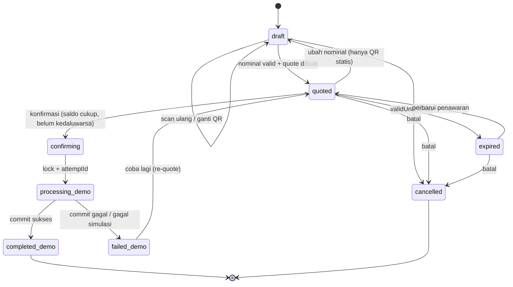

# 11 — Transaction State Machine

> Keputusan terkait: `00_DECISION_LOG.md` D-18, D-29 … D-32, D-34.

## 1. State

| State | Arti | Dipersist? |
|---|---|---|
| `draft` | Hasil scan + nominal sudah ada, belum ada quote | Tidak |
| `quoted` | Quote valid, siap dikonfirmasi (`now < validUntil`) | Tidak |
| `expired` | Quote lewat `validUntil`, konfirmasi ditolak | Tidak |
| `confirming` | Tombol ditekan, lock diambil, belum ada penulisan | Tidak |
| `processing_demo` | Proses lokal berjalan (delay kosmetik), penulisan belum selesai | Tidak |
| `completed_demo` | Penulisan state sukses | **Ya** |
| `failed_demo` | Gagal terkontrol atau gagal tulis; saldo tidak berubah | Tidak |
| `cancelled` | Pengguna membatalkan sebelum commit | Tidak |

Hanya `completed_demo` yang muncul di history. `failed_demo` boleh dicatat di debug log ringkas
(maksimal 20 entri, tanpa payload), tetapi tidak pernah di history pengguna.

## 2. Diagram



## 3. Tabel transisi dan guard

| Dari | Ke | Aksi | Guard |
|---|---|---|---|
| `draft` | `quoted` | `createQuote()` | nominal ada, dalam batas, konfigurasi valid |
| `draft` | `draft` | `replaceDraft(qr)` | scan/tempel/galeri baru; quote lama dibuang |
| `quoted` | `draft` | `editAmount()` | **hanya** `kind == static` |
| `quoted` | `confirming` | `confirm()` | `now < validUntil`, `goldUnits <= balance`, `!isCommitting` |
| `quoted` | `expired` | timer | `now >= validUntil` |
| `expired` | `quoted` | `refreshQuote()` | konfigurasi valid, saldo diperbarui |
| `confirming` | `processing_demo` | `startProcessing()` | `attemptId` sudah dibuat |
| `processing_demo` | `completed_demo` | commit sukses | readback cocok |
| `processing_demo` | `failed_demo` | commit gagal | saldo tidak berubah |
| `failed_demo` | `quoted` | `retry()` | quote baru dibuat |
| `*` (sebelum commit) | `cancelled` | `cancel()` | tidak sedang `processing_demo` |

Aturan tambahan:

- `draft` **tidak bisa** konfirmasi.
- `expired` **tidak bisa** konfirmasi, walau nominal masih sama.
- `processing_demo` tidak bisa dibatalkan; tombol back dinonaktifkan.
- "Scan ulang" dari `quoted`/`expired` kembali ke `draft` (bukan `cancelled`).
- Setiap retry memakai `attemptId` baru.

## 4. Konkurensi dan idempotensi

Mekanisme sebenarnya (bukan nama istilah):

```dart
Future<void> confirm() async {
  if (_state != TxState.quoted) return;
  if (_isCommitting) return;              // guard sinkron
  if (DateTime.now().isAfter(_quote!.validUntil)) {
    _set(TxState.expired);
    return;
  }
  final attemptId = _uuid.v4();
  _isCommitting = true;                   // set SEBELUM await apa pun
  try {
    _set(TxState.processing_demo);
    final ok = await _repository.commit(quote: _quote!, attemptId: attemptId);
    _set(ok ? TxState.completed_demo : TxState.failed_demo);
  } finally {
    _isCommitting = false;
  }
}
```

`Repository.commit` menolak jika `state.transactions.any((t) => t.attemptId == attemptId)`.

Yang **tidak** dipakai: `debounce` pada tombol, `Future.delayed` sebagai pengganti lock, atau
`setState` tanpa guard.

## 5. Perilaku saat aplikasi mati

| Titik mati | Kondisi penyimpanan | Hasil setelah restart |
|---|---|---|
| Sebelum `confirm()` | Tidak ada penulisan | Tidak ada transaksi, saldo utuh |
| Saat `processing_demo`, sebelum tulis `_prev` | Tidak ada penulisan | Tidak ada transaksi |
| Setelah `_prev` ditulis, sebelum `main` | `_prev` = state lama, `main` = state lama | Tidak ada transaksi (atau pulih ke `_prev`) |
| Setelah `main` ditulis, sebelum UI update | `main` sudah berisi transaksi | Transaksi ada di history; layar hasil dibangun dari record |
| Setelah UI update | Selesai | Normal |

Karena `processing_demo` tidak pernah dipersist, tidak mungkin ada transaksi "pending" yang
menggantung.

## 6. Sumber kebenaran UI

Layar hasil/receipt **selalu** dibangun dari `DemoTransaction` yang dibaca kembali dari repository,
bukan dari variabel controller. Jika record tidak ditemukan (mis. karena reset), tampilkan
"Transaksi tidak ditemukan" dan arahkan ke Home — jangan menampilkan struk dari memori.

## 7. Teks status

Semua teks memakai `18_UI_COPY_ID.md`:

- `processing_demo` → `status.processing`
- `completed_demo` → `status.completed` + `disclaimer.receipt`
- `failed_demo` → `status.failed` (tanpa kata "dana dikembalikan" — tidak ada dana)
- `expired` → `status.quoteExpired` + `quote.expiredBody`

## 8. Uji state machine

1. Konfirmasi ganda cepat → satu transaksi.
2. `expired` → konfirmasi ditolak, refresh berhasil.
3. Retry setelah gagal → state `quoted`, `attemptId` baru.
4. Kill app pada tiap titik di §5 (simulasi dengan flag test) → hasil sesuai tabel.
5. Back button pada `processing_demo` → tidak berpengaruh.
6. Scan ulang dari `quoted` → quote lama hilang, tidak ada potongan.
